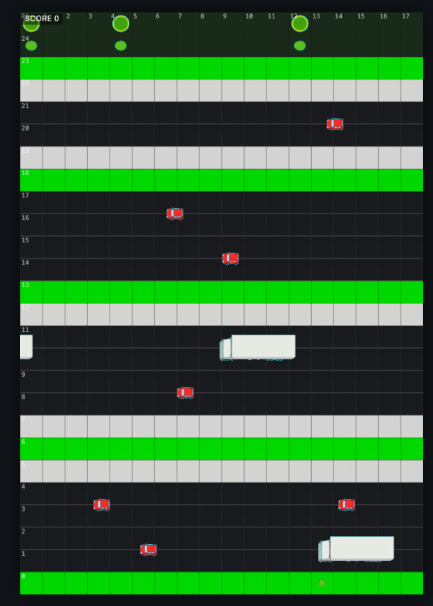
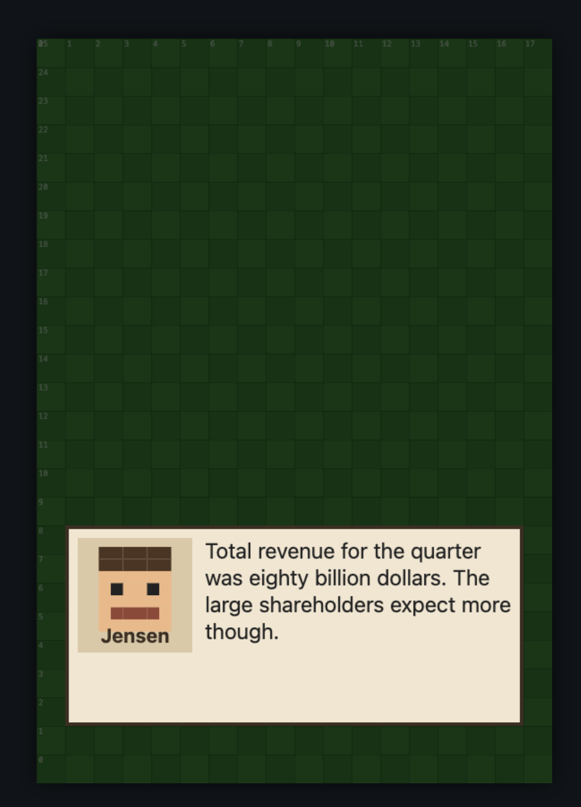
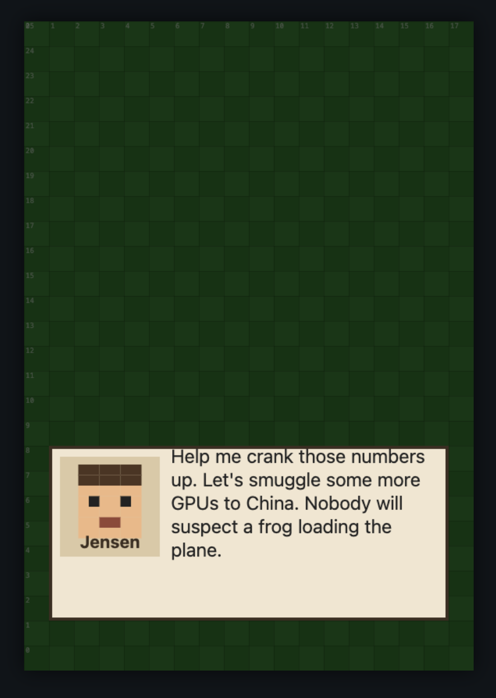

# Bob The Frog

A Frogger-style hop-across game: Bob the Frog crosses traffic lanes and rivers to reach the Localhost Lilypads.

**Play it:** <https://unbiasedbob.com/BobTheFrog/> (or open `index.html` — a local server is needed for the audio clips, e.g. `make serve`).

## The story

## How to play

- Arrow keys (or WASD) hop Bob one cell at a time.
- Cross the traffic lanes without getting hit; don't sit on water.
- Reach a Localhost Lilypad to complete the level; difficulty ramps with each completion.
- `M` toggles mute.

## Layout

- `index.html` + `js/` — the game (HTML/JS + Canvas, no framework)
- `assets/` — generated sprites, screens, and audio clips
- `test/run-tests.js` — Node test suite
- `scripts/` — asset generation + history tooling